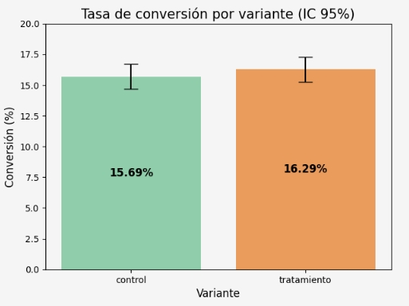
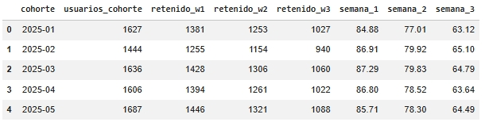
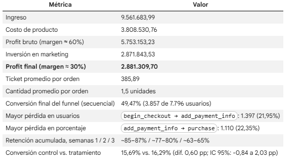

## Introducción ##

**RappiPlus** es un servicio de suscripción dentro del ecosistema de Rappi diseñado para aumentar la frecuencia de compra y el valor generado por usuario. 

## 🎯 Objetivo del proyecto ##
A lo largo de este proyecto se responderá si el negocio es rentable, si los usuarios regresan a comprar, si los cambios en las plataformas generan impacto, todo esto basado en información confiable. 

## 🗂️ Fuentes usados ##

rappiplus_orders_raw.csv

rappiplus_catalog.csv

rappiplus_marketing_spend.csv

Tabla de Events

Tabla de Users

Tabla de User Activity

experiment_checkout_ui.csv

## 🛠️ Herramientas ##

Python, SQL, pandas, numpy, seaborn y matplotlib.

## 🔍 Metodología ##

Limpieza de datasets: se encontraron duplicados, NaNs, valores negativos y outliers.

Análisis exploratorio.

Visualizaciones.

Análisis de cohortes.

Prueba estadistica: Z test.

## 🚀 Cómo ejecutar el notebook: 
 
#### ⚙️ Abrir en Google Colab:

1. Ve al archivo `.ipynb` dentro de este repositorio. 📓 [Ver notebook del análisis](Proyecto_Final.ipynb)
  
2. Haz clic en el botón **"Open in Colab"** (o copia la URL del notebook y pégala en [https://colab.research.google.com](https://colab.research.google.com) → pestaña "GitHub").
   
3. Una vez abierto, ejecuta las celdas en orden desde el menú **Runtime > Run all**.

> No necesitas instalar Python ni librerías localmente; Colab ya las incluye.

## 📝 Principales hallazgos ##

**El negocio es rentable** en el periodo, incluso después de descontar marketing.

**Marketing es la partida que más pesa:** equivale a cerca del 30% del ingreso y a casi la mitad del profit bruto.

**Funnel secuencial:** de 7.796 usuarios con `first_visit`, 3.857 llegan a `purchase` (49,47%). La pérdida se concentra en el tramo final: `begin_checkout → add_payment_info` (1.397 usuarios; 21,95%) y `add_payment_info → purchase` (1.110 usuarios; 22,35%).

**La retención acumulada es alta al inicio y baja con las semanas:** ~85% a ~87% en la semana 1 y ~63% a ~65% en la semana 3, con un comportamiento muy parecido entre cohortes.

**El cambio de UI del checkout no mostró un efecto estadísticamente significativo** (p = 0,4161).

**Las ventas están repartidas de forma pareja** entre categorías (~33% del ingreso cada una). Hogar y Moda venden más unidades que Electrónica.

## 📈 Gráficos Z test

Rappiplus realizó una modificación en la UI del checkout para evaluar si impactaba la **tasa de conversión de compra**. Para lo cual, se utilizó un Z test para su verificación. 

**Concluyendo que:** Las tasas de conversión de control (15.69%) y tratamiento (16.29%) son similares y sus intervalos de confianza al 95% se solapan. El test z (α = 0.05, p = 0.4161) y el intervalo de la diferencia [-0.84, 2.03] pp, que incluye el 0, indican que no hay evidencia estadística de que la nueva UI modifique la conversión. No rechazar H₀ no demuestra que ambas UI sean iguales: significa que con estos datos no se detectó un efecto.

## Análisis de cohortes##

### Retención por cohortes

La retención se calculó de forma acumulada por cohorte de registro (mes de `fecha_registro`). Un usuario cuenta como retenido en la semana N si estuvo activo (`activo = 1`) en la semana N o en una posterior. El denominador es el tamaño de la cohorte.

**Resultados:**
- Semana 1: ~85% a ~87% de los usuarios retenidos.
- Semana 2: ~77% a ~80%.
- Semana 3: ~63% a ~65%.

**Interpretación:** la proporción de usuarios activos disminuye unos 20 puntos entre la semana 1 y la semana 3, con un comportamiento muy parecido en las cinco cohortes (enero a mayo). No se observa una cohorte que retenga claramente mejor o peor.

**Limitaciones:** la métrica mide actividad, no compras, por lo que no permite concluir que los usuarios compren menos. Al ser acumulada, la retención es decreciente por construcción. 

## 💰 Métricas

Datos que confirman la rentabilidad de RappiPlus.

**Nota:** los dashboards que detallan esta información con gráficas y demás estan en Notion.

